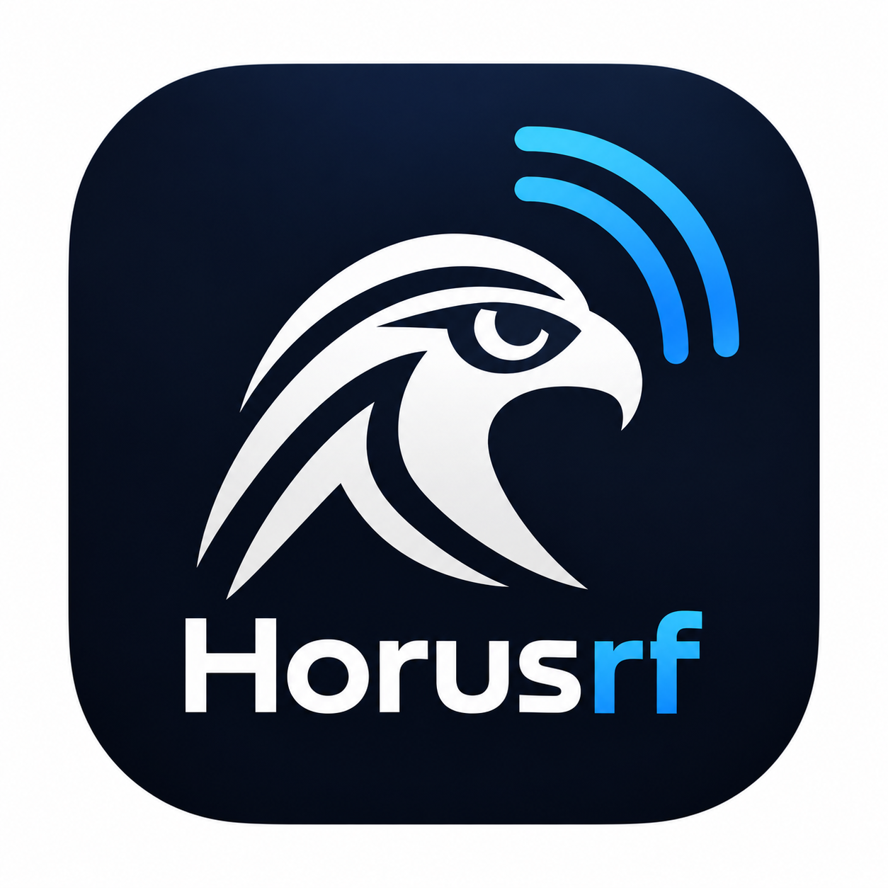

<p align="center">
  
</p>

# HorusRF

HorusRF is a C++20 declarative language for reproducible RF characterization. It
includes a typed compiler pipeline, deterministic simulated equipment, a command-line
runner, and an optional Qt Studio application.

> [!NOTE]
> HorusRF currently uses simulated equipment only. It does not provide a hardware
> backend or calibration persistence/import.

## Build

Requirements: CMake 3.20+, a C++20 compiler, and Java 11+. ANTLR and its C++ runtime
are vendored, so building and testing require no downloads.

```sh
cmake -S . -B build
cmake --build build
ctest --test-dir build --output-on-failure
```

For a multi-config generator, add `--config Debug` to the build command and `-C Debug`
to the test command.

## Run

```sh
build/horusrf-run examples/tx_path_characterization.hrf
build/horusrf-run examples/tx_path_characterization.hrf --check
build/horusrf-run examples/tx_path_characterization.hrf --csv output.csv
```

On a multi-config Debug build, use `build/Debug/horusrf-run` instead. Append `.exe`
on Windows. Run `horusrf-run --help` for all options.

The canonical example is
[`examples/tx_path_characterization.hrf`](examples/tx_path_characterization.hrf).
See the [language reference](docs/language.md) for syntax and result formats, and the
[architecture overview](docs/architecture.md) for the compiler and runtime design.

## Studio

The optional desktop application requires Qt 6 Widgets and Charts:

```sh
cmake -S . -B build -DHORUSRF_BUILD_STUDIO=ON \
  -DCMAKE_PREFIX_PATH=/path/to/Qt/6.x/gcc_64
cmake --build build
build/horusrf-studio
```

Studio provides editing, validation, execution, result visualization, and optional
local AI-assisted authoring through Ollama. Initial generation uses a packaged,
compiler-validated structural retrieval corpus with three bounded examples;
compiler repair remains diagnostic-driven and every candidate is revalidated.
On Windows, `scripts/run-studio.cmd` configures, builds, tests, and launches it.

The [small-model DSL guardrail demo](docs/ai-guardrail-demo.md) documents the
compiler-backed safety flow, controlled evaluation command, recording sequence,
and the boundary of the published development-suite claims.

To start Ollama and preload the default Qwen model on Windows, run:

```powershell
.\scripts\start-ollama.cmd
```

The launcher defaults to GPU mode. If Ollama is already running, it restarts the
local Ollama app and server so GPU selection is applied when the new server starts.
Use `-Processor Auto` to reuse a running server and allow Ollama to select the
processor, or `-Processor Cpu -RestartServer` for an explicit CPU-only restart.

## License

The language, compiler, runtime, simulator, examples, and CLI are licensed under
Apache License 2.0. The Studio application and its tests are GPL-3.0-only. See
[THIRD_PARTY_NOTICES.md](THIRD_PARTY_NOTICES.md) for third-party terms.
