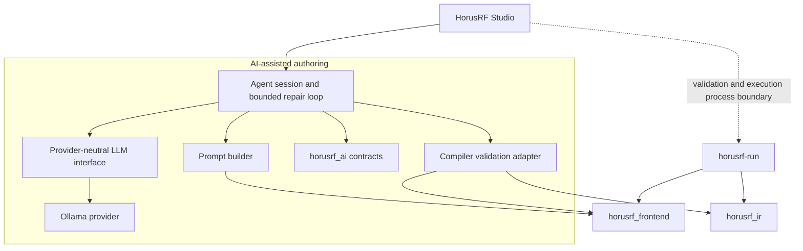

# HorusRF AI-assisted authoring architecture

Status: Milestone M0 through M5 architecture, provider, prompt, agent, and Studio
integration implemented on 2026-10-20. Golden-dataset Phase A and semantic-
comparison Phase B implemented on 2026-10-21.

## Purpose and authority

The AI-assisted authoring subsystem turns a natural-language instruction into a
HorusRF source proposal. It does not extend the language, decide that source is
correct, apply source to an editor, or execute an experiment.

Authority remains deliberately split:

1. The local language model interprets intent and proposes source.
2. The existing compiler decides whether the source is valid.
3. The user decides whether to apply the proposal and separately whether to run
   the resulting source.

Generated source is untrusted input. No successful model response may bypass
compiler validation, and no validation result authorizes execution.

## Existing components reused

| Existing contract | AI-assisted use |
|---|---|
| `frontend::validate()` | Authoritative syntax and semantic validation |
| `frontend::get_diagnostics()` | Diagnostics-only convenience API when no analyzed program is needed |
| `frontend::get_language_spec()` | Grammar-rule and fixed-token prompt context |
| `frontend::get_language_capabilities()` | Compiler-owned statements, operations, types, units, functions, and constraints |
| `ir::lower()` | Final lowering validation after successful frontend validation |
| `horusrf-run --check` | Process-level validation behavior retained by Studio |
| `studio::ExperimentRunner` | Existing asynchronous process and cancellation boundary for validation and execution |

Full compiler validation means `frontend::validate()` followed, on success, by
`ir::lower()`. This matches `horusrf-run --check`. A new parser, semantic path,
or validation rule set is not permitted in the AI subsystem.

## Components and dependency direction



The diagram is the approved dependency direction for later milestones; M0 adds
only the dependency-free `horusrf_ai` contract target. Provider transport,
validation adaptation, orchestration, and Studio integration are introduced by
their respective later milestones.

The compiler never depends on `horusrf_ai`, an LLM provider, or Qt. The authoring
core never depends on Qt. Provider-specific request and JSON types stay behind
the provider implementation. Studio remains an application layer and continues
to use `horusrf-run` as a child process for its existing Validate and Run actions.

## Public contract

`include/horusrf/ai/contracts.hpp` defines the values shared by the later
provider, validation, orchestration, and UI layers:

- `GenerationRequest` carries a natural-language instruction.
- `ModificationRequest` keeps the current source distinct from the instruction.
- `ProviderResponse` carries provider text and provider/model identity without
  exposing transport-specific data.
- `ValidationDiagnostic` preserves category, stable code, message, and source
  span. Its categories cover syntax, semantic, and IR-lowering failures.
- `ValidationResult` is either valid with no diagnostics or invalid with at
  least one diagnostic.
- `RepairAttempt` records a positive attempt number, candidate source,
  validation result, and provider identity.
- `ScriptProposal` records the final candidate, validation result, explanation,
  warnings, positive attempt count, and provider identity. It exposes no mutators and is
  eligible to apply only when validation succeeded.
- `AgentError` distinguishes invalid requests, provider and validation failures,
  repair exhaustion, cancellation, and internal failures.
- `AgentResult` is either a successful `ScriptProposal` or an `AgentFailure`.
  A failure retains the last invalid proposal and its diagnostics when available.
- `CancellationToken` uses the standard C++20 `std::stop_token`, avoiding a
  framework-specific cancellation contract.

`ScriptSource` and `NaturalLanguageInstruction` prevent source and instruction
text from being exchanged accidentally at interface boundaries. Provider and
model names remain strings because they are external identifiers.

M0 intentionally did not define the provider virtual interface or agent result
variant. Those interfaces required the error and transport behavior developed in
M2 and the state machine completed in M4.

## Provider contract and Ollama boundary

M2 adds `include/horusrf/ai/provider.hpp`. `LlmProvider` accepts a sequence of
typed system, user, and assistant messages plus a user-selected model,
temperature, output-token bound, timeout, and optional structured-output JSON
schema. It returns either the existing `ProviderResponse` or a structured
`ProviderError`. The operation is Qt-free and may block only up to its request
timeout; UI callers must schedule it on a worker thread. Cancellation uses the
M0 `std::stop_token` contract.

`horusrf_ai_ollama` implements that interface with Ollama's non-streaming local
`/api/chat` endpoint and exposes installed-model discovery through `/api/tags`.
Its HTTP request/response seam exists to permit protocol
tests without sockets. Native transport supports local `http://` endpoints,
bounded responses, connection/request/response timeouts, cancellation, content
length, and chunked responses. HTTPS and cloud fallback are deliberately absent.
Ollama JSON, HTTP types, and transport errors do not enter the provider-neutral
interface.

The implemented target dependencies are:

```text
horusrf_ai_ollama --> horusrf_ai
horusrf_ai_prompt --> horusrf_ai + horusrf_frontend
horusrf_ai_validation --> horusrf_ai + horusrf_frontend + horusrf_ir
horusrf_ai_semantic_comparison --> horusrf_frontend + horusrf_ir
horusrf_ai_agent --> horusrf_ai + horusrf_ai_prompt + horusrf_ai_validation
```

None of these edges is reversed. Compiler, IR, runtime, device, simulator, and CLI
targets do not depend on `horusrf_ai_ollama`. The M5 Studio composition target
depends on the agent and Ollama adapter while provider protocol types remain
inside its asynchronous service boundary.

## Prompt construction and proposal response

M3 adds `include/horusrf/ai/prompt.hpp` and the `horusrf_ai_prompt` target. The
Qt-free `PromptBuilder` constructs provider-neutral `LlmRequest` values for
generation, modification, and compiler-directed repair. Model selection and
request bounds remain caller-configurable.

The system context is rebuilt deterministically from the authoritative
`grammar/HorusRf.g4`, `frontend::get_language_spec()`, and
`frontend::get_language_capabilities()`, and adds the semantic rules that cannot
be reconstructed from grammar and metadata alone. The grammar is embedded at
configure time, so prompt construction has no source-tree runtime dependency. A
small mode-selected set of few-shot examples is embedded from the checked-in
`examples/` sources and covers frequency and temperature
sweeps, all current measurement operations, assertions, calibration surfaces,
and preservation during edits. Every positive proposal is compiled in the M3
test suite.

The provider is asked for exactly one object containing `status`, `script`,
`explanation`, and `warnings`. `proposal_response_schema()` supplies the strict
provider schema, and `parse_proposal_response()` independently rejects malformed
JSON, missing or incorrectly typed fields, duplicate fields, and extra fields.
Successful parsing establishes only the response shape: the candidate remains
untrusted until `validate_script()` succeeds.

## Agent orchestration

M4 adds `include/horusrf/ai/agent.hpp` and the `horusrf_ai_agent` target.
`AgentSession` synchronously coordinates prompt construction, a caller-owned
`LlmProvider`, response parsing, complete compiler validation, and at most three
repair attempts by default. Its explicit states are Idle, Generating, Validating,
Repairing, Completed, Failed, and Cancelled. It is Qt-free; a UI must invoke it
from a worker thread because provider calls may block up to their bounded timeout.

Every repaired candidate is revalidated. The session stops on success,
cancellation, provider or structured-response failure, an unchanged invalid
candidate, or repair exhaustion. A valid result is immutable and eligible to
apply. A failure carries the last validated-invalid proposal when one exists, so
source and diagnostics remain reviewable without becoming applicable.

The original instruction and, for modification, original source remain in every
repair request. Provider warnings are preserved. A compiler-capability-derived,
conservative check also warns when an explicit number-and-unit requirement does
not appear in the final candidate; this is a review aid rather than a validity
decision because equivalent unit conversions may still satisfy the request.

## CLI compatibility

M0 made no CLI changes. M1 added the explicitly selected
`--check --diagnostics=json` form while preserving existing `--check` text
diagnostics, streams, exit codes, and command syntax by default. Structured
validation emits schema `horusrf.validation-result` version 1 on stdout and uses
exit 0 for valid source or exit 4 for compiler-invalid source. The default CLI and
compiler build have no network, Ollama, or Qt dependency.

## Validation and service boundaries

The `horusrf_ai_validation` adapter depends on `horusrf_ai`, `horusrf_frontend`,
and `horusrf_ir`. It returns only the agent-facing validation values and does not
expose an AST, semantic model, or IR program to the provider. It validates in
memory for the agent repair loop and neither constructs devices nor calls runtime
code.

Studio's existing validation and run actions remain process based. The M5 agent
service uses the adapter for its bounded repair loop, but accepting a
proposal only changes editor text. Running remains an independent explicit user
action through `ExperimentRunner`.

## Studio integration

M5 adds a dockable Qt Widgets panel and a narrow `AssistantService`. The service
runs the synchronous agent or model-discovery call on one owned `std::jthread`,
propagates cancellation through `std::stop_token`, and marshals completion back to
the GUI thread. Only one authoring or discovery operation may be active, and the
service joins its worker during destruction so callbacks cannot reach destroyed
widgets. Tests inject the provider-neutral `AssistantBackend`; production composes
the same boundary with `OllamaProvider`, `PromptBuilder`, and `AgentSession`.

The panel snapshots the editor source and document revision when a request starts.
It shows an indeterminate activity indicator and live elapsed request time against
the configured timeout while Ollama, validation, and any bounded repair attempts
run. As the deadline approaches, the display switches to a timeout countdown. It
then retains the completed end-to-end response time and model-attempt count.
It displays the complete proposal, a line-oriented change view, explanation,
warnings, and validation diagnostics without modifying the editor. Apply is
enabled only for a compiler-valid proposal whose snapshot is still current. It
replaces the editor in one undoable edit block, does not save, and does not invoke
`ExperimentRunner`. Discard and retry are explicit. Endpoint, installed-model
selection, and timeout are user-configurable; provider checks never download a
model.

## Test strategy

`horusrf_ai_contract_tests` is an offline unit suite at the contract layer. It
checks request separation, provider identity, validation invariants, repair
attempt numbering, proposal apply eligibility and immutability, typed errors,
and standard cancellation behavior. It does not start a model, access a network,
read the clock, or cross a process boundary.

M1 added adapter/compiler tests at their lowest owning layer, M2 added fake-provider
transport tests, and M3 added deterministic prompt, curated-example, and response
schema tests. M4 adds deterministic generation, repair, state, failure-retention,
cancellation, modification, and fidelity-warning tests. M5 adds headless Studio
tests for proposal presentation, apply/undo, change preview, stale-document
protection, discard, cancellation, and model discovery. Real-model quality
measurement remains a separately invoked benchmark, never a deterministic CTest
dependency.

The versioned golden authoring dataset lives under `tests/ai/golden/`. The small
`horusrf_ai_golden` target owns its filesystem/schema loader and depends privately
on `horusrf_ai_validation`, so supported expected outputs pass through the same
complete compiler adapter used by the agent without broadening that adapter's
responsibility. This does not give the compiler a dependency on AI or evaluation
code. Dataset validation is deterministic and offline: it checks the manifest,
exact metadata shape, unique IDs, complete case discovery, required files, and
expected validity without invoking a provider, runtime, simulator, or device.
Unsupported requests are explicit cases with `comparison` set to `unsupported`;
they cannot be counted as compiler-valid expected programs.

Phase B adds the Qt-free `horusrf_ai_semantic_comparison` target. It compiles the
expected and candidate sources through the existing frontend and IR lowering
path, then normalizes IR value graphs for conservative structural comparison.
Canonical quantities make equivalent unit spellings equal. Characterization
names, source spans, display units, internal value IDs, and harmless identifier
renaming do not affect the result. Ordered sweep dimensions and parameters,
measurement operations, derived expressions, assertions, and calibration index
and correction semantics do. Results are `Match`, `Mismatch` with structured
differences, or `NotEvaluated` for invalid or unnormalizable input. This layer
does not infer requirements directly from natural language and does not turn
compiler validity into a semantic success.

## Recorded risks and controls

| Risk | M0 control |
|---|---|
| Frontend-only checks disagree with CLI acceptance | Full validation explicitly includes IR lowering |
| A second parser or rule set drifts from the language | All validation and language discovery reuse compiler contracts |
| Provider details spread through the application | Provider response exposes only text and provider/model identity |
| Qt leaks into reusable authoring code | `horusrf_ai` uses only the C++ standard library |
| Invalid source is offered for application | Apply eligibility is derived from successful validation |
| A presented proposal is mutated by orchestration | Proposal state is private, const, and exposed read-only |
| Cancellation becomes provider-specific | The shared token is `std::stop_token` |
| AI authoring triggers hardware | Authoring has no runtime or device dependency; execution remains a separate action |

## Milestone boundaries

M0 contains shared contracts, architecture, dependency decisions, and
deterministic contract tests. M1 contains the compiler validation adapter and
structured diagnostic JSON. M2 contains provider contracts, Ollama access, and
deterministic provider tests. M3 contains prompt assembly, curated examples, the
proposal response schema, and deterministic parsing. M4 contains bounded
generation and repair orchestration. M5 contains the asynchronous Studio service,
assistant panel, proposal review and application, configuration, discovery, and
headless UI tests. M6 and M7 retain quality evaluation, broader testing,
documentation, and demonstration work.
