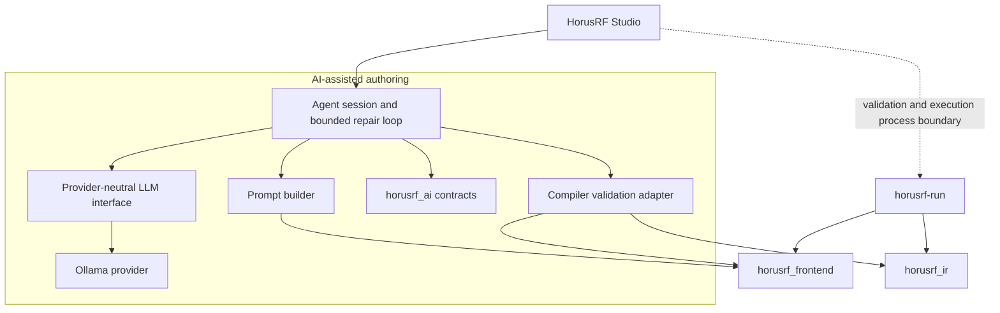

# HorusRF AI-assisted authoring architecture

Status: Milestone M0 through M5 architecture, provider, prompt, agent, and Studio
integration implemented on 2026-10-20. Golden-dataset Phase A and semantic-
comparison Phase B implemented on 2026-10-21.

## Purpose and authority

The AI-assisted authoring subsystem turns a natural-language instruction into a
HorusRF source proposal. It does not extend the language, decide that source is
correct, apply source to an editor, or execute an experiment.

Authority remains deliberately split:

1. The local language model interprets intent and proposes source.
2. The existing compiler decides whether the source is valid.
3. The user decides whether to apply the proposal and separately whether to run
   the resulting source.

Generated source is untrusted input. No successful model response may bypass
compiler validation, and no validation result authorizes execution.

## Existing components reused

| Existing contract | AI-assisted use |
|---|---|
| `frontend::validate()` | Authoritative syntax and semantic validation |
| `frontend::get_diagnostics()` | Diagnostics-only convenience API when no analyzed program is needed |
| `frontend::get_language_spec()` | Grammar-rule and fixed-token prompt context |
| `frontend::get_language_capabilities()` | Compiler-owned statements, operations, types, units, functions, and constraints |
| `ir::lower()` | Final lowering validation after successful frontend validation |
| `horusrf-run --check` | Process-level validation behavior retained by Studio |
| `studio::ExperimentRunner` | Existing asynchronous process and cancellation boundary for validation and execution |

Full compiler validation means `frontend::validate()` followed, on success, by
`ir::lower()`. This matches `horusrf-run --check`. A new parser, semantic path,
or validation rule set is not permitted in the AI subsystem.

## Components and dependency direction



The diagram is the approved dependency direction for later milestones; M0 adds
only the dependency-free `horusrf_ai` contract target. Provider transport,
validation adaptation, orchestration, and Studio integration are introduced by
their respective later milestones.

The compiler never depends on `horusrf_ai`, an LLM provider, or Qt. The authoring
core never depends on Qt. Provider-specific request and JSON types stay behind
the provider implementation. Studio remains an application layer and continues
to use `horusrf-run` as a child process for its existing Validate and Run actions.

## Public contract

`include/horusrf/ai/contracts.hpp` defines the values shared by the later
provider, validation, orchestration, and UI layers:

- `GenerationRequest` carries a natural-language instruction.
- `ModificationRequest` keeps the current source distinct from the instruction.
- `ProviderResponse` carries provider text and provider/model identity without
  exposing transport-specific data.
- `ValidationDiagnostic` preserves category, stable code, message, and source
  span. Its categories cover syntax, semantic, and IR-lowering failures.
- `ValidationResult` is either valid with no diagnostics or invalid with at
  least one diagnostic.
- `RepairAttempt` records a positive attempt number, candidate source,
  validation result, and provider identity.
- `ScriptProposal` records the final candidate, validation result, explanation,
  warnings, positive attempt count, provider identity, and typed support
  assessment. It exposes no mutators and is eligible to apply only when
  validation succeeded.
- `SupportAssessment` enumerates recognized supported, unsupported, and uncertain
  request clauses. Recognition is conservative and resolves operations against
  compiler-owned language capability metadata.
- `UnsupportedRequest` is a successful preflight outcome without a proposal or
  provider call for requests whose recognized primary operations are entirely
  unsupported.
- `AgentError` distinguishes invalid requests, provider and validation failures,
  repair exhaustion, cancellation, and internal failures.
- `AgentResult` is a `ScriptProposal`, typed `UnsupportedRequest`, or
  `AgentFailure`.
  A failure retains the last invalid proposal and its diagnostics when available.
- `CancellationToken` uses the standard C++20 `std::stop_token`, avoiding a
  framework-specific cancellation contract.

`ScriptSource` and `NaturalLanguageInstruction` prevent source and instruction
text from being exchanged accidentally at interface boundaries. Provider and
model names remain strings because they are external identifiers.

M0 intentionally did not define the provider virtual interface or agent result
variant. Those interfaces required the error and transport behavior developed in
M2 and the state machine completed in M4.

## Provider contract and Ollama boundary

M2 adds `include/horusrf/ai/provider.hpp`. `LlmProvider` accepts a sequence of
typed system, user, and assistant messages plus a user-selected model,
temperature, output-token bound, timeout, and optional structured-output JSON
schema. It returns either the existing `ProviderResponse` or a structured
`ProviderError`. The operation is Qt-free and may block only up to its request
timeout; UI callers must schedule it on a worker thread. Cancellation uses the
M0 `std::stop_token` contract.

`horusrf_ai_ollama` implements that interface with Ollama's non-streaming local
`/api/chat` endpoint and exposes installed-model discovery through `/api/tags`.
Its HTTP request/response seam exists to permit protocol
tests without sockets. Native transport supports local `http://` endpoints,
bounded responses, connection/request/response timeouts, cancellation, content
length, and chunked responses. HTTPS and cloud fallback are deliberately absent.
Ollama JSON, HTTP types, and transport errors do not enter the provider-neutral
interface.

The implemented target dependencies are:

```text
horusrf_ai_ollama --> horusrf_ai
horusrf_ai_prompt --> horusrf_ai + horusrf_frontend
horusrf_ai_validation --> horusrf_ai + horusrf_frontend + horusrf_ir
horusrf_ai_requirements --> horusrf_ai + horusrf_domain + horusrf_frontend + horusrf_ir
horusrf_ai_semantic_comparison --> horusrf_frontend + horusrf_ir
horusrf_ai_agent --> horusrf_ai + horusrf_ai_prompt + horusrf_ai_validation + horusrf_ai_requirements
horusrf_ai_evaluation --> horusrf_ai_agent + horusrf_ai_golden + horusrf_ai_semantic_comparison
horusrf-ai-eval --> horusrf_ai_evaluation + horusrf_ai_ollama
```

None of these edges is reversed. Compiler, IR, runtime, device, simulator, and CLI
targets do not depend on `horusrf_ai_ollama`. The M5 Studio composition target
depends on the agent and Ollama adapter while provider protocol types remain
inside its asynchronous service boundary.

## Prompt construction and proposal response

M3 adds `include/horusrf/ai/prompt.hpp` and the `horusrf_ai_prompt` target. The
Qt-free `PromptBuilder` constructs provider-neutral `LlmRequest` values for
generation, modification, and compiler-directed repair. Model selection and
request bounds remain caller-configurable.

The system context is rebuilt deterministically from the authoritative
`grammar/HorusRf.g4`, `frontend::get_language_spec()`, and
`frontend::get_language_capabilities()`, and adds the semantic rules that cannot
be reconstructed from grammar and metadata alone. The grammar is embedded at
configure time, so prompt construction has no source-tree runtime dependency. A
small mode-selected set of few-shot examples is embedded from the checked-in
`examples/` sources and covers frequency and temperature
sweeps, all current measurement operations, assertions, calibration surfaces,
and preservation during edits. Every positive proposal is compiled in the M3
test suite.

The provider is asked for exactly one object containing `status`, `script`,
`explanation`, and `warnings`. `proposal_response_schema()` supplies the strict
provider schema, and `parse_proposal_response()` independently rejects malformed
JSON, missing or incorrectly typed fields, duplicate fields, and extra fields.
Successful parsing establishes only the response shape: the candidate remains
untrusted until `validate_script()` succeeds.

## Agent orchestration

M4 adds `include/horusrf/ai/agent.hpp` and the `horusrf_ai_agent` target.
`AgentSession` synchronously coordinates prompt construction, a caller-owned
`LlmProvider`, response parsing, complete compiler validation, and at most three
repair attempts by default. Its explicit states are Idle, Generating, Validating,
Repairing, Completed, Failed, and Cancelled. It is Qt-free; a UI must invoke it
from a worker thread because provider calls may block up to their bounded timeout.

Every repaired candidate is revalidated. The session stops on success,
cancellation, provider or structured-response failure, an unchanged invalid
candidate, or repair exhaustion. A valid result is immutable and eligible to
apply. A failure carries the last validated-invalid proposal when one exists, so
source and diagnostics remain reviewable without becoming applicable.

The original instruction and, for modification, original source remain in every
repair request. Provider warnings are preserved. After compiler success, a
conservative interactive extractor converts explicit supported requirements to
typed clauses, retaining source text and offsets, and verifies them against a
read-only projection of the lowered IR. Canonical quantities accept equivalent
unit spellings. Explicit assertion phrases include inclusive limits and strict
`below`, `less than`, `above`, and `greater than` forms, including their
unambiguous `strictly` variants. Explicit calibration correction phrases are
projected to a typed
reference-minus-measured or measured-minus-reference relation and compared with
the compiler-normalized correction expression. A calibration request whose
direction is not explicit remains an ambiguous unknown so the evaluation gate
requires review instead of treating an unchecked sign as satisfied. The product
Apply boundary remains unchanged.
Recognized ambiguity remains unknown rather than
becoming an invented requirement. The immutable proposal reports requirement
satisfaction separately from compiler validity; this is a review diagnostic and
does not alter Apply eligibility in M6Q.3.

## CLI compatibility

M0 made no CLI changes. M1 added the explicitly selected
`--check --diagnostics=json` form while preserving existing `--check` text
diagnostics, streams, exit codes, and command syntax by default. Structured
validation emits schema `horusrf.validation-result` version 1 on stdout and uses
exit 0 for valid source or exit 4 for compiler-invalid source. The default CLI and
compiler build have no network, Ollama, or Qt dependency.

## Validation and service boundaries

The `horusrf_ai_validation` adapter depends on `horusrf_ai`, `horusrf_frontend`,
and `horusrf_ir`. It returns only the agent-facing validation values and does not
expose an AST, semantic model, or IR program to the provider. It validates in
memory for the agent repair loop and neither constructs devices nor calls runtime
code.

Studio's existing validation and run actions remain process based. The M5 agent
service uses the adapter for its bounded repair loop, but accepting a
proposal only changes editor text. Running remains an independent explicit user
action through `ExperimentRunner`.

## Studio integration

M5 adds a dockable Qt Widgets panel and a narrow `AssistantService`. The service
runs the synchronous agent or model-discovery call on one owned `std::jthread`,
propagates cancellation through `std::stop_token`, and marshals completion back to
the GUI thread. Only one authoring or discovery operation may be active, and the
service joins its worker during destruction so callbacks cannot reach destroyed
widgets. Tests inject the provider-neutral `AssistantBackend`; production composes
the same boundary with `OllamaProvider`, `PromptBuilder`, and `AgentSession`.
Production Studio packages the compiler-validated structural retrieval corpus next
to the executable, validates it once on the worker thread, and uses
`structural-rag-v1` with K=3 for initial generation. Retrieval remains absent from
repair and requirement-correction requests. A missing or invalid packaged corpus
stops authoring with an explicit configuration failure before any provider call;
Studio never silently falls back to the baseline prompt.

The panel snapshots the editor source and document revision when a request starts.
It shows an indeterminate activity indicator and live elapsed request time against
the configured timeout while Ollama, validation, and any bounded repair attempts
run. As the deadline approaches, the display switches to a timeout countdown. It
then retains the completed end-to-end response time and model-attempt count.
It displays the complete proposal, a line-oriented change view, explanation,
warnings, compiler diagnostics, and per-clause requirement verification without
modifying the editor. Failed compiler repair is labeled as a rejected candidate,
selects the Validation tab, and distinguishes untrusted model explanations and
warnings from authoritative compiler diagnostics. A compiler-valid proposal that
still needs requirement review is labeled separately. Apply is
enabled only for a compiler-valid proposal whose snapshot is still current. It
replaces the editor in one undoable edit block, does not save, and does not invoke
`ExperimentRunner`. Discard and retry are explicit. Endpoint, installed-model
selection, and timeout are user-configurable; provider checks never download a
model. The selection widget associates its friendly display text with the exact
Ollama identifier used by generation, modification, and repair. That identifier
is persisted with `QSettings`. Discovery retains it when still installed; if it
has disappeared, Studio selects a deterministic installed fallback and tells the
user which change was made. Configuration controls are disabled for the lifetime
of an active request, whose copied model identifier cannot change in flight.

## Test strategy

`horusrf_ai_contract_tests` is an offline unit suite at the contract layer. It
checks request separation, provider identity, validation invariants, repair
attempt numbering, proposal apply eligibility and immutability, typed errors,
and standard cancellation behavior. It does not start a model, access a network,
read the clock, or cross a process boundary.

M1 added adapter/compiler tests at their lowest owning layer, M2 added fake-provider
transport tests, and M3 added deterministic prompt, curated-example, and response
schema tests. M4 adds deterministic generation, repair, state, failure-retention,
cancellation, modification, and fidelity-warning tests. M5 adds headless Studio
tests for proposal presentation, apply/undo, change preview, stale-document
protection, discard, cancellation, model discovery, friendly 3B/7B presentation,
exact identifier propagation, selection persistence, and missing-model fallback.
Real-model quality measurement remains a separately invoked benchmark, never a
deterministic CTest dependency.

The versioned golden authoring dataset lives under `tests/ai/golden/`. The small
`horusrf_ai_golden` target owns its filesystem/schema loader and depends privately
on `horusrf_ai_validation`, so supported expected outputs pass through the same
complete compiler adapter used by the agent without broadening that adapter's
responsibility. This does not give the compiler a dependency on AI or evaluation
code. Dataset validation is deterministic and offline: it checks the manifest,
exact metadata shape, unique IDs, complete case discovery, required files, and
expected validity without invoking a provider, runtime, simulator, or device.
Unsupported requests are explicit cases with `comparison` set to `unsupported`;
they cannot be counted as compiler-valid expected programs.

Phase B adds the Qt-free `horusrf_ai_semantic_comparison` target. It compiles the
expected and candidate sources through the existing frontend and IR lowering
path, then normalizes IR value graphs for conservative structural comparison.
Canonical quantities make equivalent unit spellings equal. Characterization
names, source spans, display units, internal value IDs, and harmless identifier
renaming do not affect the result. Ordered sweep dimensions and parameters,
measurement operations, derived expressions, assertions, and calibration index
and correction semantics do. Results are `Match`, `Mismatch` with structured
differences, or `NotEvaluated` for invalid or unnormalizable input. This layer
does not infer requirements directly from natural language and does not turn
compiler validity into a semantic success.

Phase D adds the Qt-free `horusrf_ai_evaluation` target and the opt-in
`horusrf-ai-eval` executable. The evaluator runs golden prompts through the
existing agent, records every bounded provider attempt, validates the final
candidate again, and invokes semantic comparison only for supported cases.
Unsupported cases are reported separately from the typed preflight outcome;
evaluation does not inspect free-form explanation or warning text. Evaluation never reaches runtime,
simulator, or device targets.

Reports use schema `horusrf.ai-evaluation` version 4. They retain generated source,
requested and actual provider identity, every provider attempt, compiler outcomes,
strict semantic differences, clause-level curated and interactive requirement outcomes,
the deterministic allow/review/reject acceptance decision and reason codes, repair counts,
errors, latency, explicit rate denominators, prompt sizes, run order, warm/cold
classification, and optional provider-neutral inference telemetry. Ollama duration
and token fields are adapted into that optional telemetry; unavailable fields
remain JSON `null`. Structural-RAG reports add corpus schema/version/digest,
ranking and budget settings, the complete positive-score candidate ranking beyond
K, per-case selection diagnostics and cost, and aggregate retrieval coverage,
latency, and context cost. Candidates beyond K are observability only and are not
inserted into provider prompts. The evaluator does not maintain a
C++ report reader; the checked-in
evaluation tests inject scripted providers and a deterministic clock. Live model
evaluation is invoked explicitly through the executable or
`scripts/run-ai-evaluation.ps1`, writes under `build/` by default, and is not a
CTest dependency. Selected gate and milestone runs are archived as compact,
immutable `horusrf.ai-evaluation-history` version-2 snapshots under
`evaluation/history/`; they retain aggregate and per-case trend data plus the
full report's SHA-256, while attempt-level raw reports remain ignored build
artifacts. `scripts/archive-ai-evaluation.ps1` creates a snapshot from a
schema-v1, schema-v2, schema-v3, or schema-v4 report, preserving unavailable legacy fields as `null`,
and the live runner's `-Archive` switch performs that step after a successful
run. The evaluator accepts four versioned prompt configurations:
the unchanged `direct-dsl-v1` default, `direct-dsl-compact-v1` with compact
comment-free examples, and `direct-dsl-relevant-v1` with deterministic
feature-tag selection, and opt-in `structural-rag-v1` with a validated local
corpus and explicit ranking/budget settings. Prompt configuration is evaluation input and remains
independent of the compiler, runtime, and Studio execution boundaries.
Studio explicitly selects `structural-rag-v1` K=3 for authoring; the evaluator
continues to require an explicit configuration so experiments remain reproducible.
The evaluation-only acceptance decision rejects incomplete, invalid, unsupported,
or interactively violated proposals; routes partial, uncertain, unknown, and
not-evaluated outcomes to review; and allows only completed, compiler-valid,
supported proposals whose extracted interactive requirements are satisfied. The
independent curated requirement result is used only to score accepted precision.
This observability does not alter `ScriptProposal::eligible_to_apply()` or Studio's
Apply control.

## Recorded risks and controls

| Risk | M0 control |
|---|---|
| Frontend-only checks disagree with CLI acceptance | Full validation explicitly includes IR lowering |
| A second parser or rule set drifts from the language | All validation and language discovery reuse compiler contracts |
| Provider details spread through the application | Provider response exposes text, provider/model identity, and optional provider-neutral telemetry only |
| Qt leaks into reusable authoring code | `horusrf_ai` uses only the C++ standard library |
| Invalid source is offered for application | Apply eligibility is derived from successful validation |
| A presented proposal is mutated by orchestration | Proposal state is private, const, and exposed read-only |
| Cancellation becomes provider-specific | The shared token is `std::stop_token` |
| AI authoring triggers hardware | Authoring has no runtime or device dependency; execution remains a separate action |

## Milestone boundaries

M0 contains shared contracts, architecture, dependency decisions, and
deterministic contract tests. M1 contains the compiler validation adapter and
structured diagnostic JSON. M2 contains provider contracts, Ollama access, and
deterministic provider tests. M3 contains prompt assembly, curated examples, the
proposal response schema, and deterministic parsing. M4 contains bounded
generation and repair orchestration. M5 contains the asynchronous Studio service,
assistant panel, proposal review and application, configuration, discovery, and
headless UI tests. M6 contains the golden dataset, semantic comparison, model
selection, opt-in live evaluation, and broader deterministic testing. M7 retains
user documentation and demonstration work.

M6 quality hardening adds a Qt-free compiler-backed `ProgramFacts` projection and
curated golden requirement schema. The requirement verifier reports each explicit
clause as satisfied, violated, unknown, or unsupported. Exact full-program
comparison remains a separate strict signal; compiler validity and requirement
satisfaction are not conflated. This layer depends on frontend validation and IR
lowering only and has no runtime, simulator, device, output, or Studio dependency.
