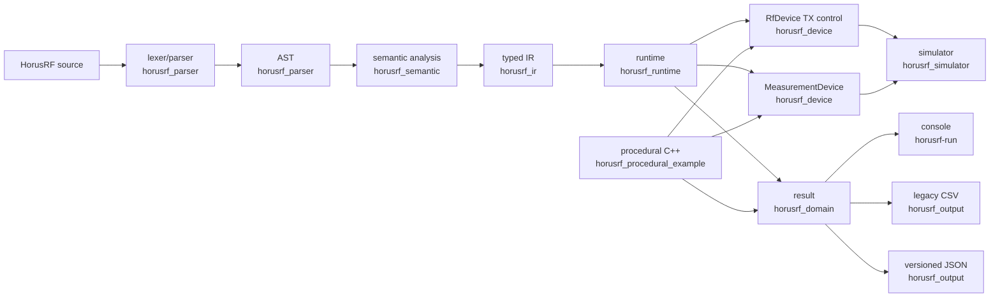
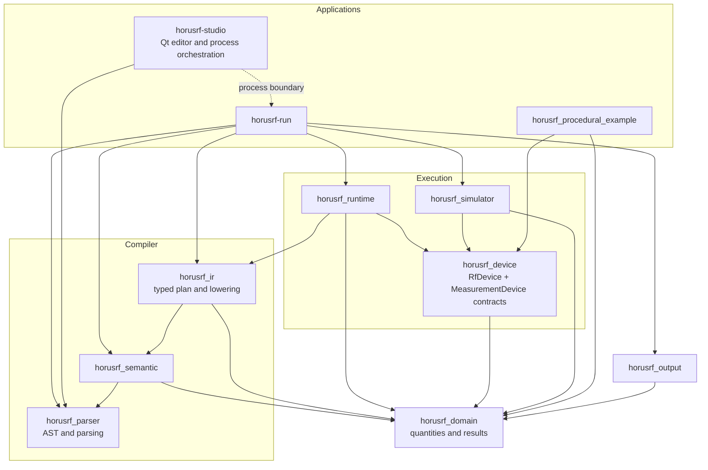
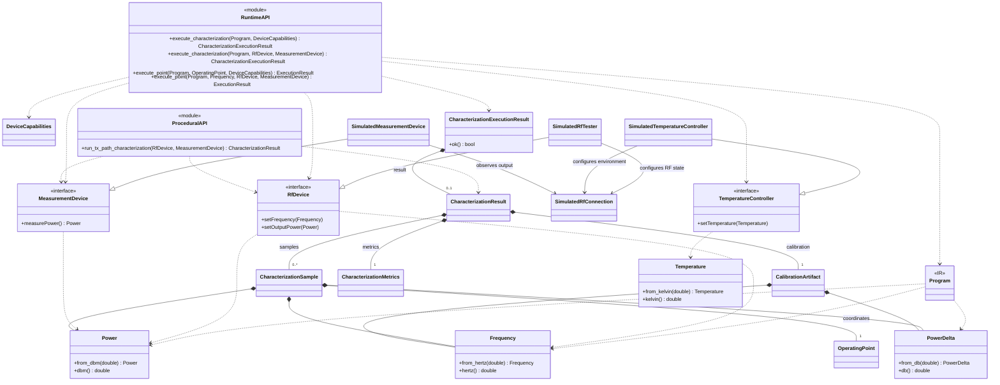
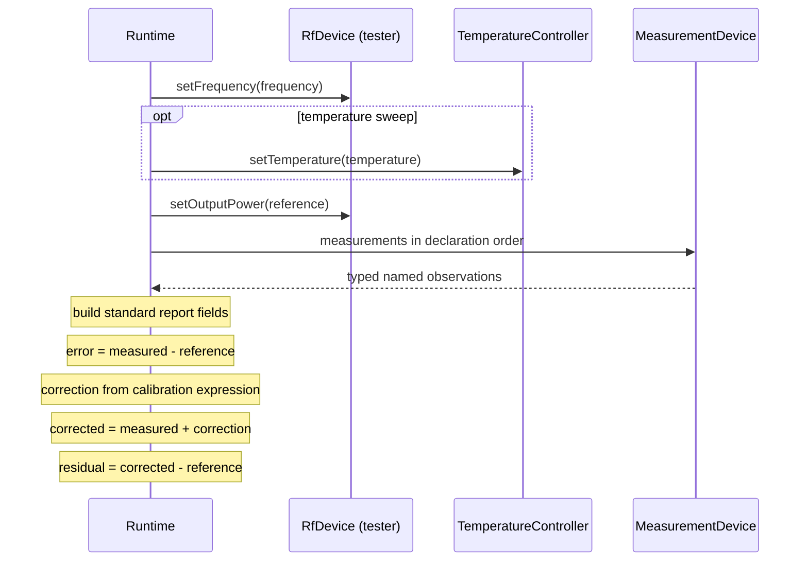

# HorusRF architecture

## Context and physical model

HorusRF is a focused demonstration of what a declarative DSL for RF
characterization could look like. Its reference experiment characterizes an
imperfect tester transmit path: the runtime sets a nominal output power and a
frequency through the TX-only `RfDevice` contract, then obtains power through a
separate `MeasurementDevice` contract. Named EVM and frequency-error observations
use `EvmMeasurementDevice` and `FrequencyErrorMeasurementDevice`, while
environmental control uses `TemperatureController`. The deterministic simulator implements these as
simulated instruments connected by an opaque connection object. The measurement
equipment is part of the physical setup; it is not a separately programmable DSL
instrument. The
measured-minus-reference error produces an equal and opposite correction.

The public result owns its samples, ordered named observations and derived values,
typed operating-point coordinates, ordered calibration dimension descriptors and
coordinate/correction entries. It does not
alias source text, compiler storage, a device, or simulator state.
`CharacterizationSample` is also the standard verification report for one point:
domain code consistently calculates raw error, corrected power, and residual error
from the reference, measurement, and calibration correction for both declarative
and procedural execution.

## Compile and execution flow

`horusrf-run` composes the parser, semantic analyzer, lowerer, runtime, simulator,
and output layer. The procedural example independently orchestrates the experiment
and joins the declarative path only at domain quantities, the `RfDevice` and
`MeasurementDevice` contracts, the simulator, and result/metric types. It does not
use compiler or runtime orchestration.

## Component dependencies

The execution flow above shows how data moves through the system. The following
view instead shows allowed compile-time dependency direction. An arrow points from
a component to a component it may depend on; it does not imply ownership or call
order.

The CLI is the composition root, so its broad dependencies do not relax the
dependencies of the components it assembles. In particular, runtime reaches
simulated or future hardware implementations only through `RfDevice`,
`MeasurementDevice`, `EvmMeasurementDevice`, `FrequencyErrorMeasurementDevice`,
and `TemperatureController`. `RfDevice` is intentionally the tester TX-control
boundary; it has no measurement operation. Studio's parser dependency supplies
fixed-token metadata for highlighting; its dotted CLI edge represents validation
and execution through a process boundary.

## Public contracts and ownership

This high-level class view intentionally omits AST nodes, semantic expressions,
individual IR operations, diagnostics, the optional EVM/frequency-error observation
interfaces, and private simulator state. It shows selected stable contracts that
cross architectural boundaries. Filled diamonds denote owned result data; dashed
arrows denote use through parameters or return values.

## Representation and ownership boundaries

- The AST preserves written statement/expression structure and source spans. It has
  no semantic, device, or runtime dependency.
- The language frontend's authoritative concrete syntax is `grammar/HorusRf.g4`.
  `horusrf_parser` generates its production lexer and parser from that grammar,
  constructs the existing AST, and maps failures into existing structured
  diagnostics without exposing ANTLR types. Its public fixed-token metadata is
  derived from the generated lexer vocabulary and classifies keywords, units,
  operators, and punctuation using HorusRF types. Studio builds its lightweight
  highlighter rules from that metadata, so it neither duplicates keyword/unit
  spellings nor parses each edited block. The
  [ANTLR cutover decision](adr/0002-adopt-antlr-generated-parser.md) records the
  boundary; the earlier recursive-descent decision is retained as history.
- `horusrf_frontend` is the Qt-free language-service boundary. Its public
  `frontend::parse()` and `frontend::validate()` operations return structured
  results rather than parse exceptions, classify diagnostics as syntax or
  semantic, and preserve stable codes, messages, and source spans. Validation
  stops before IR lowering, runtime, device construction, or hardware access.
  `frontend::get_diagnostics()` is the diagnostics-only view of validation.
  `frontend::get_language_spec()` exposes rule names and fixed tokens obtained
  from generated ANTLR metadata. `frontend::get_language_capabilities()` combines
  that compiler-owned lexical data with domain unit classification and semantic
  definition tables for measurements, sweeps, functions, and limits. Returned
  metadata is immutable, deterministically ordered, and contains no ANTLR types.
  The lower-level parser and semantic APIs remain available for compatibility
  and focused compiler-layer use. The CLI consumes this boundary; Studio reaches
  it through the CLI's existing asynchronous `--check` process workflow.
- `horusrf_ai_validation` depends on the dependency-free AI contracts, frontend,
  and IR. It performs complete in-memory compiler validation, returns only the AI
  validation contract, and never exposes a compiler program or reaches runtime or
  devices. The explicitly selected `--check --diagnostics=json` CLI form
  serializes this same contract.
- Semantic analysis resolves declarations, references, dimensions, expression
  types, calibration indexes, and canonical units.
- IR is a typed, device-independent plan of values and operations. Runtime consumes
  it without depending on AST shape.
- Runtime executes IR only through caller-owned `RfDevice` and explicit measurement
  and control capability abstractions. Supplied devices must
  remain alive for the call; returned results do not refer to them.
- `Frequency`, `FrequencyDelta`, `Ratio`, `Power`, `PowerDelta`, samples, artifacts,
  and metrics are shared domain values. CSV is a terminal presentation layer and
  does not feed execution.

## Runtime sequence and failure behavior

For each operating point, equipment calls and computation occur in this order:

The sweep is generated by integer index from its canonical-Hz start and step. An
endpoint on the step lattice is included with a small floating-point tolerance; a
non-divisible range stops at the last point below the endpoint. A sweep permits at
most 1,000,000 points. Every declared measurement occurs once per point, and sample,
calibration dimension, and correction vectors remain aligned. Metrics are calculated
only after all points succeed.

IR and sweep validation happen before equipment calls. Equipment exceptions propagate:
there is no retry and no partial `CharacterizationResult` is returned.

The compiler represents declaration-ordered frequency and temperature sweeps with
checked axis and product counts. Runtime executes their Cartesian product with the
last declared dimension varying fastest and
preflights the explicit `TemperatureController` capability before equipment access,
then applies sweep controls in declaration order before output power and measurements.
It supports declaration-ordered named power, EVM, and frequency-error measurements,
strong `Ratio` and `FrequencyDelta` values, and whole-program capability preflight.

## Dependencies, determinism, and extension points

The target-level dependency rules are:

| Target | Allowed direct project dependencies |
|---|---|
| `horusrf_parser` | AST/parser headers and the private vendored ANTLR runtime |
| `horusrf_domain` | none |
| `horusrf_semantic` | domain, parser/AST |
| `horusrf_ai` | none; Qt-free AI-assisted authoring value contracts |
| `horusrf_ai_validation` | AI contracts, frontend, IR; no runtime or device dependency |
| `horusrf_ir` | domain; semantic only while lowering |
| `horusrf_device` | domain |
| `horusrf_runtime` | IR, device, domain |
| `horusrf_simulator` | device, domain |
| `horusrf_procedural_example` | device, domain |
| `horusrf_output` | domain |
| `horusrf-run` | composition of the implemented layers |
| `horusrf-studio` | parser metadata, Qt Widgets, and Qt Charts; validates and executes through `horusrf-run` |

Domain code must not depend on compiler layers. AST must not depend on semantic,
runtime, or device code. Runtime must not access simulator internals, and procedural
orchestration must not depend on the compiler or runtime. The simulator's
deterministic TX-path response is a private implementation function: the tester
publishes only resulting power to the opaque connection, and measurement exposes
only `measurePower()`. Strong dBm/dB types make cross-layer dimensional intent
explicit.

Studio is a separate application layer. It writes the current editor buffer to a
temporary source file and invokes the sibling `horusrf-run` executable asynchronously
for validation or execution. It links `horusrf_parser` for fixed-token highlighting
metadata, but does not invoke parsing there or link semantic, IR, runtime, device,
simulator, or output targets. Structured source diagnostics are parsed from standard
error for navigation while raw standard output and standard error remain distinct. A
successful run's versioned JSON is validated and parsed into a typed, Studio-owned
results model.
Studio presents multidimensional tables and filters, selectable one-dimensional
plots, two-dimensional heatmaps, qualification summaries and grouped failures, and
calibration entries. Assertion failures retain source spans for editor navigation.
The strict legacy CSV parser and original frequency charts remain compatibility
presentation paths; Studio never recomputes domain values or calibration results.
The most recent valid results remain visible if a later run or result load fails.
The GPL-3.0-only desktop application may consume the Apache-2.0 parser library while
remaining separately licensed; it does not change the licenses of core targets.

Language discovery and validation are safe automation boundaries, not execution
authorization. Generated source is always treated as untrusted and must pass
validation. Hardware execution remains a separate application action requiring
explicit user approval; capability discovery and validation cannot construct or
call a device. No LLM client, agent orchestration, MCP transport, or unrestricted
execution belongs in the compiler frontend.

The dependency-free `horusrf_ai` target owns the shared AI-assisted authoring
value contracts. `horusrf_ai_validation` adapts the existing frontend and IR
lowerer into those contracts without a runtime or device dependency. Later
provider, prompt, and orchestration code may depend on the contracts and adapter,
while compiler targets must not depend on the AI subsystem. The approved component
boundaries, validation definition, CLI
compatibility decisions, and risks are recorded in the
[AI-assisted authoring architecture](ai-assisted-authoring-architecture.md).

## Deliberately limited scope

The architecture leaves boundaries at which a larger system could add real hardware
implementations of `RfDevice` and `MeasurementDevice`, richer calibration artifacts,
explicit application syntax, or alternative compiler backends. They illustrate how
the design separates concerns; they are not a roadmap. The demonstration has no
hardware backend, persisted calibration, general instrument model, optimizer,
bytecode, or LLVM integration.
