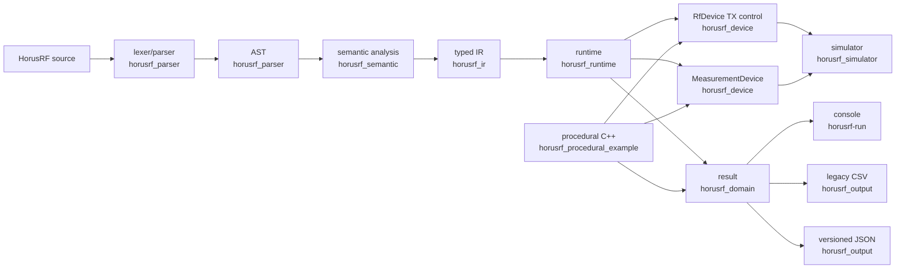
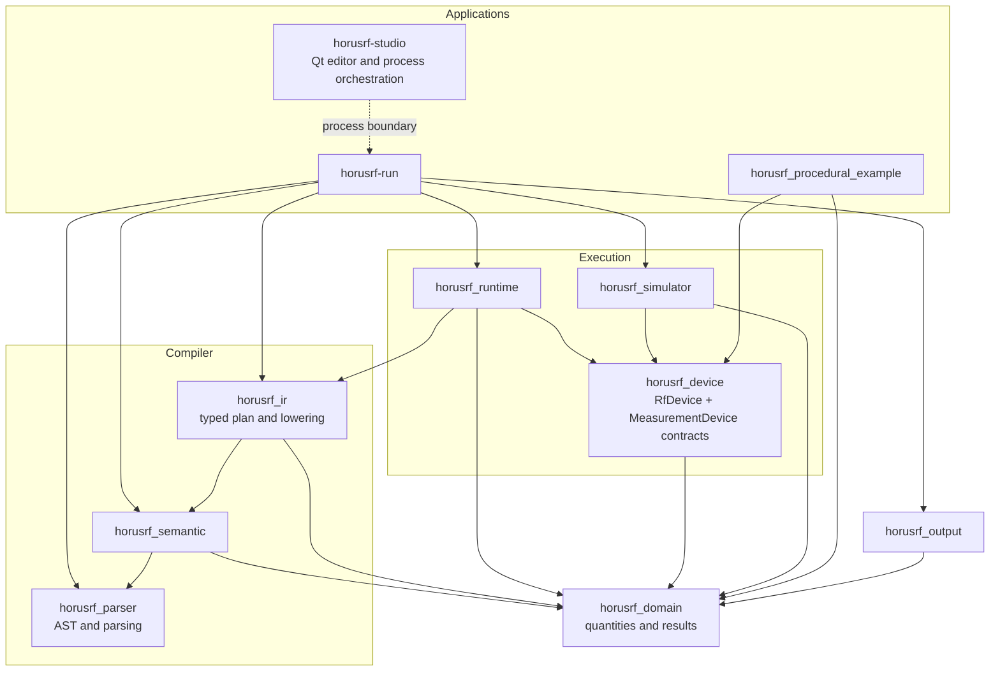
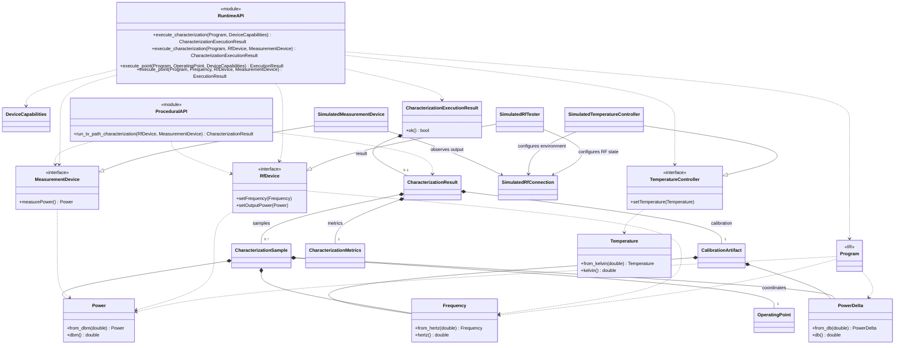
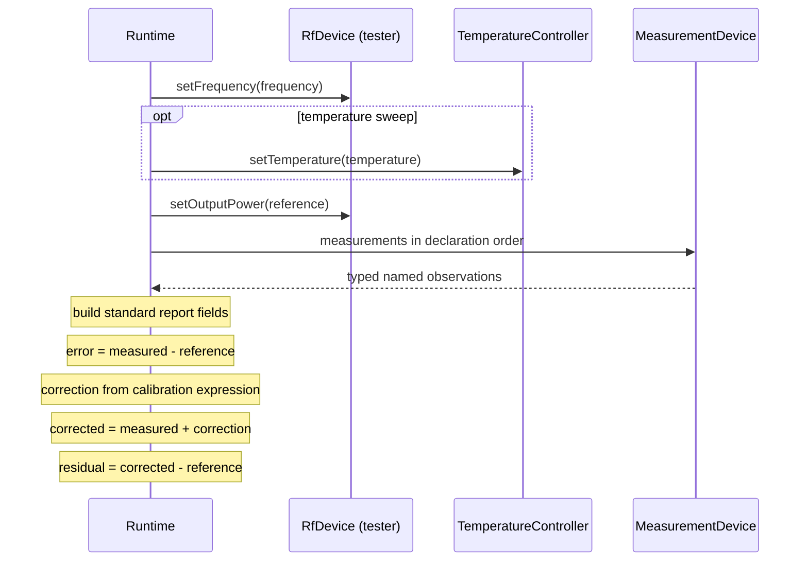

# HorusRF architecture

## Context and physical model

HorusRF is a focused demonstration of what a declarative DSL for RF
characterization could look like. Its reference experiment characterizes an
imperfect tester transmit path: the runtime sets a nominal output power and a
frequency through the TX-only `RfDevice` contract, then obtains power through a
separate `MeasurementDevice` contract. Named EVM and frequency-error observations
use `EvmMeasurementDevice` and `FrequencyErrorMeasurementDevice`, while
environmental control uses `TemperatureController`. The deterministic simulator implements these as
simulated instruments connected by an opaque connection object. The measurement
equipment is part of the physical setup; it is not a separately programmable DSL
instrument. The
measured-minus-reference error produces an equal and opposite correction.

The public result owns its samples, ordered named observations and derived values,
typed operating-point coordinates, ordered calibration dimension descriptors and
coordinate/correction entries. It does not
alias source text, compiler storage, a device, or simulator state.
`CharacterizationSample` is also the standard verification report for one point:
domain code consistently calculates raw error, corrected power, and residual error
from the reference, measurement, and calibration correction for both declarative
and procedural execution.

## Compile and execution flow

`horusrf-run` composes the parser, semantic analyzer, lowerer, runtime, simulator,
and output layer. The procedural example independently orchestrates the experiment
and joins the declarative path only at domain quantities, the `RfDevice` and
`MeasurementDevice` contracts, the simulator, and result/metric types. It does not
use compiler or runtime orchestration.

## Component dependencies

The execution flow above shows how data moves through the system. The following
view instead shows allowed compile-time dependency direction. An arrow points from
a component to a component it may depend on; it does not imply ownership or call
order.

The CLI is the composition root, so its broad dependencies do not relax the
dependencies of the components it assembles. In particular, runtime reaches
simulated or future hardware implementations only through `RfDevice`,
`MeasurementDevice`, and `TemperatureController`. `RfDevice` is intentionally the
tester TX-control boundary; it has no measurement operation.

## Public contracts and ownership

This high-level class view intentionally omits AST nodes, semantic expressions,
individual IR operations, diagnostics, and private simulator state. It shows the
stable contracts that cross architectural boundaries. Filled diamonds denote
owned result data; dashed arrows denote use through parameters or return values.

## Representation and ownership boundaries

- The AST preserves written statement/expression structure and source spans. It has
  no semantic, device, or runtime dependency.
- Semantic analysis resolves declarations, references, dimensions, expression
  types, calibration indexes, and canonical units.
- IR is a typed, device-independent plan of values and operations. Runtime consumes
  it without depending on AST shape.
- Runtime executes IR only through caller-owned `RfDevice` and explicit measurement
  and control capability abstractions. Supplied devices must
  remain alive for the call; returned results do not refer to them.
- `Frequency`, `FrequencyDelta`, `Ratio`, `Power`, `PowerDelta`, samples, artifacts,
  and metrics are shared domain values. CSV is a terminal presentation layer and
  does not feed execution.

## Runtime sequence and failure behavior

For each operating point, equipment calls and computation occur in this order:

The sweep is generated by integer index from its canonical-Hz start and step. An
endpoint on the step lattice is included with a small floating-point tolerance; a
non-divisible range stops at the last point below the endpoint. A sweep permits at
most 1,000,000 points. Every declared measurement occurs once per point, and sample,
calibration dimension, and correction vectors remain aligned. Metrics are calculated
only after all points succeed.

IR and sweep validation happen before equipment calls. Equipment exceptions propagate:
there is no retry and no partial `CharacterizationResult` is returned.

M1 generalizes the compiler representation to declaration-ordered frequency and
temperature sweeps with checked axis and product counts. M2 executes their
Cartesian product with the last declared dimension varying fastest. Runtime
preflights the explicit `TemperatureController` capability before equipment access,
then applies sweep controls in declaration order before output power and measurements.
M3 adds declaration-ordered named power, EVM, and frequency-error measurements,
strong `Ratio` and `FrequencyDelta` values, and whole-program capability preflight.

## Dependencies, determinism, and extension points

The target-level dependency rules are:

| Target | Allowed direct project dependencies |
|---|---|
| `horusrf_parser` | AST/parser headers only |
| `horusrf_domain` | none |
| `horusrf_semantic` | domain, parser/AST |
| `horusrf_ir` | domain; semantic only while lowering |
| `horusrf_device` | domain |
| `horusrf_runtime` | IR, device, domain |
| `horusrf_simulator` | device, domain |
| `horusrf_procedural_example` | device, domain |
| `horusrf_output` | domain |
| `horusrf-run` | composition of the implemented layers |
| `horusrf-studio` | Qt Widgets and Charts only; communicates with `horusrf-run` through a process boundary |

Domain code must not depend on compiler layers. AST must not depend on semantic,
runtime, or device code. Runtime must not access simulator internals, and procedural
orchestration must not depend on the compiler or runtime. The simulator's
deterministic TX-path response is a private implementation function: the tester
publishes only resulting power to the opaque connection, and measurement exposes
only `measurePower()`. Strong dBm/dB types make cross-layer dimensional intent
explicit.

Studio is a separate application layer. It writes the current editor buffer to a
temporary source file and invokes the sibling `horusrf-run` executable asynchronously
for validation or execution. It never links compiler, runtime, device, simulator,
or output targets. Structured source diagnostics are parsed from standard error for
navigation while raw standard output and standard error remain distinct. A successful
run's versioned JSON is validated and parsed into a typed, Studio-owned results model.
Studio presents multidimensional tables and filters, selectable one-dimensional
plots, two-dimensional heatmaps, qualification summaries and grouped failures, and
calibration entries. Assertion failures retain source spans for editor navigation.
The strict legacy CSV parser and original frequency charts remain compatibility
presentation paths; Studio never recomputes domain values or calibration results.
This path does not introduce a core or output-library link. The most recent valid
results remain visible if a later run or result load fails. This keeps the GPL-3.0-only
desktop application outside the Apache-2.0 core and CLI target graph.

## Approved Phase 1 evolution boundaries

The accepted M0 design is specified in
[`docs/dsl-evolution.md`](dsl-evolution.md). M1's typed sweep compiler
representation, M2's typed Cartesian runtime, and M3's named measurement pipeline
are implemented; assertions and qualification were added in M4, and calibration
surfaces plus versioned JSON were added in M5. Studio JSON integration was completed
in M6 without changing the dependency direction.

- Parser, AST, semantic analysis, and IR generalize in their existing order. AST
  remains syntactic; semantic analysis resolves typed names and operations; IR
  remains a typed, device-independent plan.
- Sweep and result coordinates retain their declaration-ordered name, stable type,
  and strong `Frequency` or `Temperature` value. They are never flattened to
  untyped numbers. The last declared sweep dimension varies fastest.
- Environmental control is a separate `TemperatureController` interface. Optional
  EVM and frequency-error observations use explicit public capability interfaces.
  `RfDevice` remains TX control, `MeasurementDevice::measurePower()` remains the
  legacy power contract, and existing execution overloads remain as adapters.
- Runtime validates the whole plan, sweep product, and required capabilities before
  any equipment call. At a point it applies sweep controls in declaration order,
  sets output power, performs measurements in declaration order, and then evaluates
  pure derived values, assertions, and calibration data.
- Assertions produce owned qualification outcomes and do not control execution.
  Non-finite observations or computations remain execution failures rather than
  failed assertions.
- Multidimensional and qualification results use versioned JSON. The original CSV
  remains a terminal, exact schema for only the legacy experiment shape. Studio
  ingests JSON through the existing CLI process boundary and owns all presentation
  models, filters, plot selection, heatmap mapping, and qualification grouping.
- Calibration-fit, qualification, and independent-validation metrics are distinct.
  No in-sample calibration statistic is labeled as validation.

The generalized dependency direction is therefore unchanged. New device contracts
belong to `horusrf_device`, their strong values and owned result structures belong
to `horusrf_domain`, execution belongs to `horusrf_runtime`, JSON serialization
belongs to `horusrf_output`, and the CLI remains the composition root. Simulator
implementations may satisfy the new device interfaces but are never runtime
dependencies.

Fresh simulator instances with the same calls produce identical observations. The
simulator model remains private. Console, CSV, and JSON output use the classic
locale and round-trip-capable numeric precision, so results do not vary with host
locale. JSON serialization depends only on the owned domain result and does not
reach into IR, runtime, devices, or simulator state.

### Deliberately limited scope

The architecture leaves boundaries at which a larger system could add real hardware
implementations of `RfDevice` and `MeasurementDevice`, richer calibration artifacts,
explicit application syntax, or alternative compiler backends. They illustrate how
the design separates concerns; they are not a roadmap. The demonstration has no
hardware backend, persisted calibration, general instrument model, optimizer,
bytecode, or LLVM integration.
